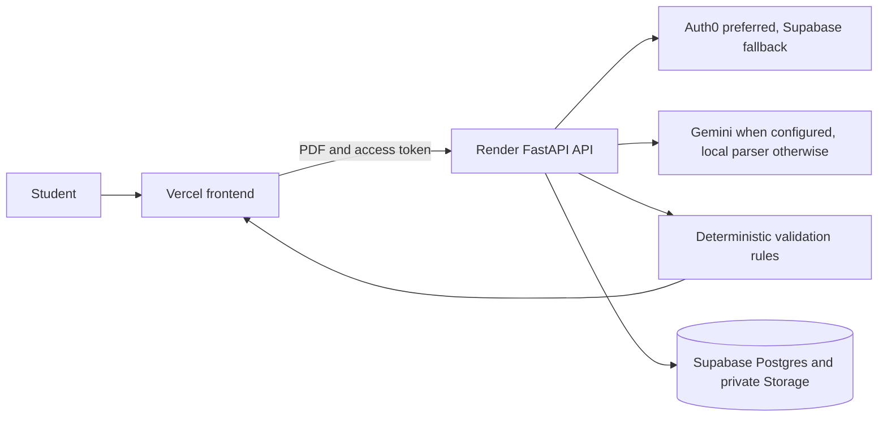

# Muni

**Documents look funi? Save your muni!**

Muni helps students review financial documents in one place. Upload award letters, tuition bills, and study-abroad quotes, then see the details worth double-checking before contacting a school or provider.

## Live demo

[Open Muni](https://www.makemuni.us)

The repository includes synthetic PDFs, so the demo can be run without using real student records. The short presentation flow is in [`docs/demo-script.md`](docs/demo-script.md).

## What Muni does

- Extracts key fields from financial PDFs
- Groups charges, aid, payments, and estimates by academic term
- Flags mismatched amounts, missing credits, deadlines, coverage gaps, and possible duplicate charges
- Lets students correct extracted fields and rerun a check
- Provides a document-grounded assistant with confirmation required for changes

Findings are prompts to verify, not financial, legal, or eligibility decisions.

## How it works



The frontend uses Auth0 when its settings are present and falls back to Supabase Auth otherwise. The API verifies the token before scoping every document operation to the signed-in user. Supabase stores the application data and private PDFs. More detail is in [`docs/architecture.md`](docs/architecture.md).

## Submission notes

- Frontend: React and Vite, deployed on Vercel
- Backend: FastAPI, deployed on Render
- Storage: Supabase Postgres and private object storage
- Extraction: local PDF parser with optional Gemini classification and extraction
- Demo data: synthetic PDFs only, including a two-term scenario with intentional mismatches

The main environment values are listed in [`frontend/.env.example`](frontend/.env.example) and [`backend/.env.example`](backend/.env.example). Provider secrets are not committed.

## Checks

Frontend:

```bash
cd frontend
npm ci
npm run build
npm test
```

Backend:

```bash
cd backend
python -m pytest
ruff check app tests
```

The application is designed for planning support. Students should confirm important details with their financial-aid office or provider.
