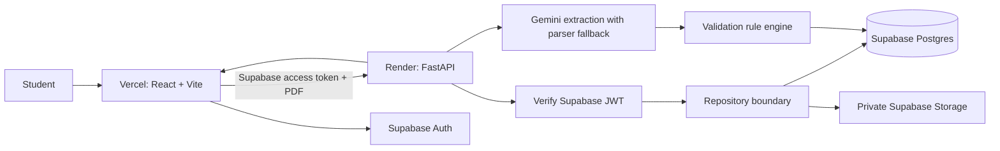

# EduCash — Student Financial Cross-Check

**Manage scholarships, tuition bills, and study-abroad costs in one place. Catch details worth double-checking and leave with a clearer next step.**

ClearLedger extracts labeled fields from student financial PDFs, compares them with explainable validation rules, and helps students prepare questions for their school or award provider. Findings are prompts to verify—not financial advice or eligibility decisions.

## Architecture



The React app authenticates with Supabase Auth. The API verifies the access token, uses the verified user ID to scope every repository operation, and accesses Postgres/private Storage with a server-only service key. **Every database and object-storage operation belongs in [`backend/app/db/repositories.py`](backend/app/db/repositories.py).**

The frontend-to-backend feature mapping and pending API work are tracked in [`docs/api-gaps.md`](docs/api-gaps.md).

## Deployment

- Backend: Render blueprint in [`render.yaml`](render.yaml).
- Frontend: Vercel project rooted at `frontend/`, with SPA rewrites in [`frontend/vercel.json`](frontend/vercel.json).
- Database, Auth, and private document storage: apply the Supabase migrations in [`backend/supabase/migrations/`](backend/supabase/migrations/) in timestamp order.
- Step-by-step provider setup, secrets, and smoke checks: [deployment guide](docs/deployment.md).
- **Live demo:** not published yet. Deploy the Render Blueprint and Vercel project using the deployment guide, then add their public URLs here.

Provider accounts and secrets are not available in this workspace, so the deployment configuration is prepared but no live Render or Vercel deployment has been created from this checkout.

## Local development

Requirements: Python 3.11+, Node.js 22+, npm. Local API mode uses in-memory repositories if Supabase credentials are absent. For authenticated local development, configure a Supabase project and copy the app-specific env examples.

```bash
# Terminal 1 — backend (WSL/Linux)
cd backend
python -m pip install -e ".[test]"
python -m uvicorn app.main:app --reload

# Terminal 2 — frontend
cd frontend
npm ci
npm run dev
```

Open `http://localhost:5173`; backend health is at `http://localhost:8000/health`, and API docs are at `http://localhost:8000/docs`.

For local Supabase-backed development, apply all migrations in timestamp order to your Supabase project, copy `backend/.env.example` to `backend/.env`, set its Supabase values, and set `REQUIRE_AUTH=true`. Set `LLM_API_KEY` and `LLM_MODEL` on the backend only if you want Gemini extraction; no model is selected by default. Copy `frontend/.env.example` to `frontend/.env.local` and set the Supabase URL and anon/publishable key. Never put service-role or LLM secrets in frontend variables.

## API

All API paths are prefixed by `/api`.

| Method | Path | Purpose |
|---|---|---|
| `POST` | `/documents` | Upload a PDF to private Storage, optionally accept a user-selected type, and classify/extract fields |
| `GET` | `/documents?state=active\|archived\|deleted` | List documents in the selected state (defaults to active) |
| `GET` | `/documents/{id}` | Read document fields and extraction status |
| `PATCH` | `/documents/{id}` | Correct extracted fields |
| `POST` | `/documents/{id}/reextract` | Re-run extraction while retaining user-corrected fields |
| `POST` | `/documents/{id}/archive` | Archive a document without removing its file |
| `POST` | `/documents/{id}/restore` | Restore an archived or soft-deleted document |
| `POST` | `/documents/{id}/delete` | Soft-delete a document without removing its file |
| `DELETE` | `/documents/{id}` | Permanently delete the private file and document row |
| `GET` | `/findings` | Compute current findings from active, successfully extracted documents |
| `POST` | `/validations` | Validate all extracted user documents or the supplied `document_ids` |
| `GET` | `/validations/{run_id}` | Load a saved validation report |
| `POST` | `/insights` | Create a student-oriented summary from `{ "run_id": "..." }` |
| `POST` | `/ai/chat` | Ask the authenticated user's financial planning assistant; returns reply, suggestions, sources, and pending write actions |
| `POST` | `/ai/actions/{id}/confirm` | Explicitly confirm a pending archive, restore, correction, or re-extraction action |
| `POST` | `/ai/actions/{id}/cancel` | Cancel a pending AI-proposed write action |

The upload UI performs a validation using only the newly uploaded, successfully extracted documents. After a student corrects a field on a report, the app calls `PATCH /documents/{id}`, starts a new validation run, and opens the refreshed report.
The chat agent requires backend-only `LLM_API_KEY` and `LLM_MODEL` settings and does not save conversation history. Its read/write tool list, confirmation gate, and threat model are described in [`docs/agent-design.md`](docs/agent-design.md).

## Project commands

- `make dev` — start the backend API.
- `make test` — run backend tests.
- `make seed` — locate the synthetic sample files.
- `cd frontend && npm run build` — type-check and build the frontend.
- `cd backend && ruff check app tests` — lint the backend.
- `cd backend && python scripts/eval_extraction.py` — optionally compare Gemini extraction against synthetic scenario rules; exits with a skip message if `LLM_API_KEY` or `LLM_MODEL` is unset.

## Synthetic demo data

Use only PDFs under `sample_docs/`. Scenario 1 intentionally disagrees on term, deadline, and credits. Scenario 2 pairs a scholarship with a study-abroad quote. Each scenario's `expected.json` lists the expected rule IDs. The PDFs are synthetic and contain no real student data.

## Data, safety, and limitations

- Supabase is the production persistence path; local development falls back to in-memory repositories only when backend Supabase credentials are absent.
- Uploaded PDFs are stored in a private bucket, scoped under the authenticated user's ID. The backend checks ownership and deletes the Storage object as part of document deletion.
- The API uses a server-only Supabase service key; Supabase Auth access tokens are verified server-side. Production mode refuses to start without auth and Supabase configuration.
- When `LLM_API_KEY` and `LLM_MODEL` are configured, the backend sends the PDF bytes to Gemini for one structured classification-and-extraction call. Gemini failures, timeouts, rate limits, server errors, and invalid responses fall back to the local PDF text parser. Without an API key/model, the parser is used directly. Image-only PDFs fail extraction; OCR is not implemented.
- Gemini receives PDF bytes separately from its instructions; PDF text is treated as untrusted data. Prompts prohibit extracting SSNs, bank/card numbers, government IDs, student IDs, and home addresses. The application does not store extracted PDF text or log the model output. Review Google's API data-handling terms before sending real financial documents.
- Insight summaries are deterministic rules-based prompts; no document text is sent to an LLM.
- Use synthetic data for demos and development. Real financial records need a reviewed retention, deletion, backup, incident-response, and compliance policy before launch.

See the [three-minute demo script](docs/demo-script.md), [architecture](docs/architecture.md), [data model](docs/data-model.md), and [validation rules](docs/validation-rules.md).
