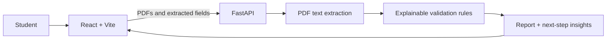

# The Vibe Coders — Student Financial Cross-Check

**Keep scholarships, tuition bills, and study-abroad costs in view—then catch the details worth double-checking.**

Students often coordinate award letters, tuition bills, and program quotes from different sources. This app extracts key facts from selectable-text PDFs, highlights potential inconsistencies, and suggests practical questions to ask a school or provider. Findings are prompts to verify—not financial advice or eligibility decisions.

> **Demo status:** This is a hackathon prototype. It currently processes text-based PDFs, keeps reports in backend memory, and is not suitable for real student financial data. Use synthetic sample documents only.

## Architecture



More detail: [architecture](docs/architecture.md), [data model](docs/data-model.md), and [validation rules](docs/validation-rules.md).

## Quick start

Requirements: Python 3.11+, Node.js 22+, npm. GNU Make is needed for the `make` targets; PowerShell alternatives are shown below.

```powershell
# Terminal 1 — API
Set-Location backend
python -m pip install -e ".[test]"
python -m uvicorn app.main:app --reload

# Terminal 2 — web app
Set-Location frontend
npm install
npm run dev
```

Open the Vite URL, normally `http://localhost:5173`. Backend health: `http://localhost:8000/health`; interactive API docs: `http://localhost:8000/docs`.

Copy `backend/.env.example` to `backend/.env` and `frontend/.env.example` to `frontend/.env.local` only if you need to change defaults. Never commit real secrets. Root `.env.example` contains notes only.

## Commands

- `make dev` — run the backend API (`Set-Location backend; python -m uvicorn app.main:app --reload` in PowerShell).
- `make test` — run backend tests (`Set-Location backend; python -m pytest`).
- `make seed` — print the location of synthetic sample PDFs.
- `cd frontend && npm run build` — type-check and build the frontend.

## Try the synthetic mismatch

Upload both PDFs in `sample_docs/scenario_1_mismatch/`. The award letter says **Fall 2026**, **$12,000**, **12 credits**, and a **July 15** deadline; the bill says **Spring 2026**, **$18,000**, **6 credits**, and an **August 1** due date. See `expected.json` for expected finding IDs. The fixture content is synthetic and for demonstration only.

## API at a glance

- `POST /api/documents/extract` — multipart PDFs plus document types; returns typed extracted fields.
- `POST /api/validations` — validate two or more extracted document records.
- `GET /api/validations` and `GET /api/validations/{id}` — list or retrieve in-memory reports.
- `GET /api/insights/{id}` — return report-based student next steps.

## Privacy and current limitations

- The demo does not send PDFs to an LLM. Extraction uses embedded text and basic labeled-field patterns; image-only PDFs need OCR, which is not included.
- Reports are in-memory and disappear when the API restarts. Supabase wiring is a starting point, not durable storage.
- Auth is off for local development. Enabling `REQUIRE_AUTH` requires a compatible Supabase HS256 JWT secret; production key rotation, per-user authorization, private storage, and deletion/retention controls still need implementation.
- Never upload real student financial documents to this prototype.

## Demo flow

Follow the [three-minute demo script](docs/demo-script.md).
