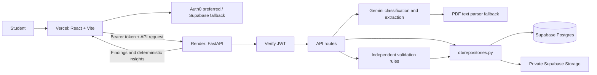

# Architecture

## Trust boundaries

- Auth0 issues user sessions when configured; otherwise Supabase Auth does. The API validates the selected JWT signature, audience, issuer, and subject before handling protected routes.
- Supabase is always the persistence layer and can also provide fallback authentication. The Supabase service key is backend-only. The API scopes Auth0-backed operations by a deterministic UUID derived from the verified Auth0 `sub`; frontend users never receive the service key.
- All Postgres and Storage calls are in `backend/app/db/repositories.py`. `backend/app/db/supabase.py` only constructs the shared service client.
- The Storage bucket is private and policies scope direct user access to a first path segment equal to `auth.uid()`. The backend stores objects at `{user_id}/{document_id}.pdf`.
- Postgres RLS policies protect user-owned data. Backend service-role access bypasses RLS, so repository-level owner filters are also required and tested.
- Vercel serves a static SPA. The Render API permits only configured `CORS_ORIGINS`.

## Request flow

1. The frontend signs a student in with Auth0 when configured, or Supabase Auth as fallback, and attaches the access token to API requests.
2. `POST /api/documents` validates and uploads a PDF, stores document metadata, and runs one structured Gemini classification/extraction call when configured; otherwise, or on a handled Gemini failure, it uses the selectable-text parser fallback. The full envelope and legacy fields are persisted in `documents.extracted_json`.
3. The student can correct parsed values with `PATCH /api/documents/{id}`.
4. `POST /api/documents/{id}/reextract` repeats extraction without replacing user-edited fields.
5. `POST /api/validations` loads the student's extracted documents from the repository and runs the independent rule objects.
6. The run and findings are saved to Postgres. `GET /api/validations/{run_id}` powers the report; `POST /api/insights` returns deterministic follow-up suggestions.
7. `DELETE /api/documents/{id}` removes the user's private Storage object and Postgres row.

## Extraction and insights

When `LLM_API_KEY` and `LLM_MODEL` are configured, Gemini receives the PDF bytes as a PDF part separate from its instructions and returns a structured document envelope. The prompt treats PDF contents as untrusted data and prohibits collecting SSNs, bank/card numbers, government IDs, student IDs, or home addresses. Values must be present in the document; totals are not calculated and missing values are not inferred. Timeouts, 429/5xx responses, and invalid output fall back to the PDF text parser. Without an API key and model, the parser is used directly. Image-only PDFs are marked `failed`; OCR is not included. Extraction logs contain IDs, duration, source, and error class only; they never include document text or model output. Insights remain deterministic templates based on findings, not an LLM call.

## Persistence modes

When backend Supabase URL and service-key settings are present, repository methods use Supabase Postgres and Storage. Auth0 domain and audience settings are preferred for API authentication; Supabase JWT settings remain supported as a fallback. Local development without Supabase credentials uses in-memory state so synthetic scenarios can run without external services; this state is intentionally non-durable. `APP_ENV=production` requires Supabase persistence and at least one authentication provider.
