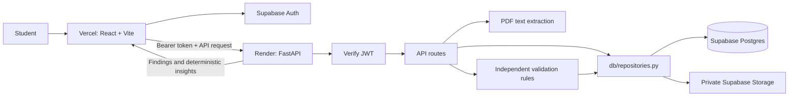

# Architecture

## Trust boundaries

- Supabase Auth issues user sessions. The API validates the Supabase HS256 JWT signature, audience, and subject before handling protected routes.
- The Supabase service key is backend-only. The API scopes document and run operations by the verified JWT `sub`; frontend users never receive the service key.
- All Postgres and Storage calls are in `backend/app/db/repositories.py`. `backend/app/db/supabase.py` only constructs the shared service client.
- The Storage bucket is private and policies scope direct user access to a first path segment equal to `auth.uid()`. The backend stores objects at `{user_id}/{document_id}.pdf`.
- Postgres RLS policies protect user-owned data. Backend service-role access bypasses RLS, so repository-level owner filters are also required and tested.
- Vercel serves a static SPA. The Render API permits only configured `CORS_ORIGINS`.

## Request flow

1. The frontend signs a student in with Supabase Auth and attaches the access token to API requests.
2. `POST /api/documents` validates and uploads a PDF, stores document metadata, extracts selectable text, and persists the typed fields in `documents.extracted_json`.
3. The student can correct parsed values with `PATCH /api/documents/{id}`.
4. `POST /api/validations` loads the student's extracted documents from the repository and runs the independent rule objects.
5. The run and findings are saved to Postgres. `GET /api/validations/{run_id}` powers the report; `POST /api/insights` returns deterministic follow-up suggestions.
6. `DELETE /api/documents/{id}` removes the user's private Storage object and Postgres row.

## Extraction and insights

The PDF extractor reads selectable text and uses explicit labels and dates; it never invents missing values. Image-only PDFs are marked `failed`. OCR is not included. Insights are deterministic templates based on findings, not an LLM call. `LLM_API_KEY` is reserved for a future reviewed adapter; the current application does not transmit financial documents to a model.

## Persistence modes

When backend Supabase URL and service-key settings are present, repository methods use Supabase Postgres and Storage. Local development without those credentials uses in-memory state so the synthetic scenarios can run without external services; this state is intentionally non-durable. `APP_ENV=production` requires Auth and Supabase configuration and does not silently fall back.
