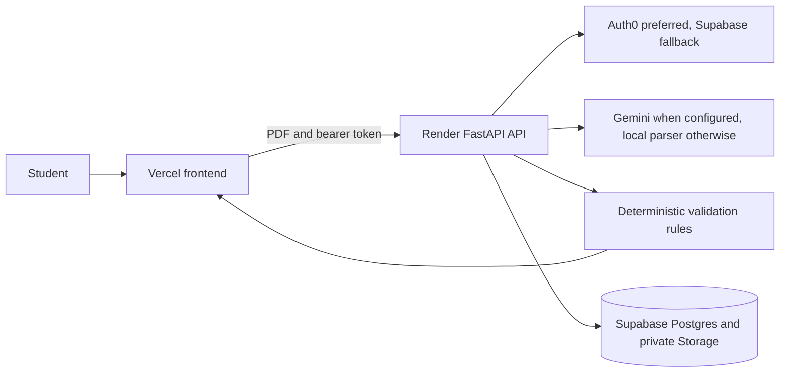

# How Muni works

The frontend signs the student in, sends the PDF to the API, and displays the extracted fields and findings. Auth0 is preferred. Supabase Auth is supported as a fallback. The API verifies the token and scopes every repository operation to that user.

Muni uses Gemini only when the backend has a model key and model name. The prompt asks for fields that appear in the document and treats PDF content as untrusted data. If Gemini is unavailable, the local text parser handles selectable-text PDFs. Image-only PDFs need OCR, which is not included in this version.

Validation is deterministic. The rule engine groups charges, aid, payments, and estimates by academic term, keeps currencies separate, and reports evidence with each finding. Insights are generated from the findings and do not send document text to an LLM.

Supabase stores the application data and private PDFs. The backend uses the service key, never the browser. Files are stored under the authenticated user's ID, and repository methods apply the same user scope to database reads and writes.
