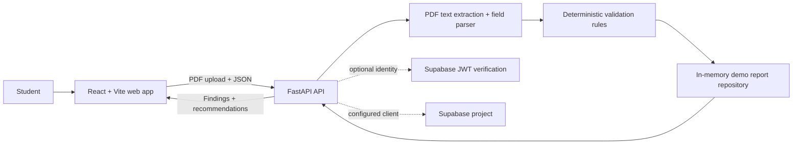

# Architecture

The app extracts selectable text from PDFs, parses common financial fields, compares those fields, and returns explainable findings. It does not upload documents to a third-party LLM. Image-only PDFs are rejected with an actionable message; OCR is not enabled.

## Local demo and production boundary

The current repository is a local hackathon demo: API reports are held in process memory and disappear on restart. The Supabase client and optional HS256 Supabase JWT verification are integration points, not a persistent storage implementation. Do not use this demo to store real financial records. A production deployment needs per-user authorization, private object storage, persistent report/document repositories, retention/deletion controls, encrypted transport/storage, and key-rotation-aware Supabase JWT validation. Enable `REQUIRE_AUTH` only when configured with the project's compatible JWT secret.

## Request flow

1. The web app posts two or more PDF files and one document type per file to `POST /api/documents/extract`.
2. The API validates file type/size, reads embedded PDF text, and returns typed extracted fields.
3. The browser submits extracted records to `POST /api/validations`.
4. The validation engine executes the documented rules and returns a report.
5. The insights endpoint provides next-step prompts based on those findings.

## Boundaries

- `schemas/` owns API contracts.
- `services/extraction/` owns PDF parsing and field extraction.
- `services/validation/` owns deterministic, testable rules.
- `api/routes/` owns HTTP request/response handling.
- `db/repositories.py` is a demo-only in-memory repository seam.
